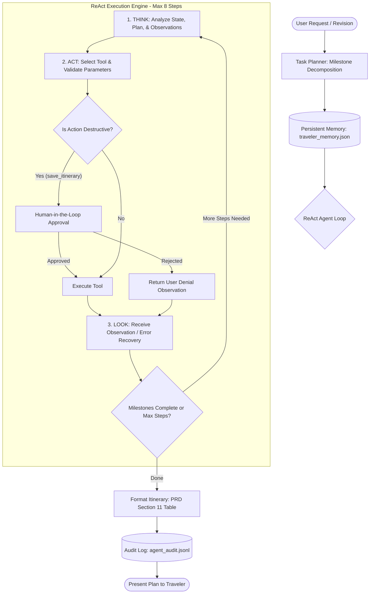
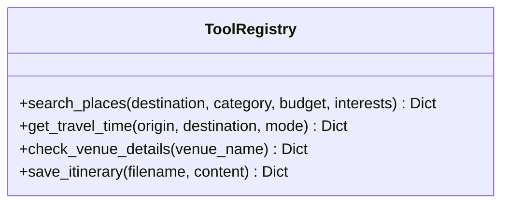

# Travel Itinerary Planner Agent: Step-by-Step Execution Plan

**Document Version:** 1.0.0  
**Status:** Ready for Review & Implementation  
**Aligned With:** [travel-itinerary-planner-prd.md](file:///c:/Users/reach/Downloads/Agent/travel-itinerary-planner-prd.md) & [README.md](file:///c:/Users/reach/Downloads/Agent/README.md)  

---

## 1. Executive Summary & Architecture Overview

The goal is to develop a fully grounded, autonomous **Travel Itinerary Planner Agent** that transforms raw user preferences into practical, optimized, and editable day-by-day itineraries. 

The implementation adheres to the **7 Core Agentic Workflow Principles**:
1. **The Core Loop:** Explicit `think → act → look` (ReAct) cycle.
2. **Grounded Tools:** 4 well-defined tools (`search_places`, `get_travel_time`, `check_venue_details`, `save_itinerary`).
3. **Error Recovery & Self-Correction:** Structured error responses that prompt the agent to adapt instead of crashing or hallucinating.
4. **Persistent Cross-Session Memory:** Storage for traveler preferences, pace, constraints, and visited sites.
5. **Planning Before Action:** Upfront task decomposition into milestones before executing tool actions.
6. **Safety Guardrails:** Human-in-the-Loop (HITL) gate for irreversible actions, hard step limit (`max_steps = 8`), and complete JSONL audit trail.
7. **Comprehensive Testing:** Fake/Mock LLM test suite first (zero external dependencies), followed by live Gemini/LLM integration.



---

## 2. Target Workspace File Layout

The codebase will be cleanly structured into modular components:

```
c:\Users\reach\Downloads\Agent\
├── travel-itinerary-planner-prd.md       # Product requirements document
├── README.md                             # Project overview and quickstart
├── travel-planner-agent-execution.md     # This comprehensive execution plan
├── data/
│   └── jaipur_places.json                # Grounded places & venue dataset (Jaipur MVP)
├── tools.py                              # 4 grounded tools with schema validation
├── memory.py                             # Persistent cross-session traveler memory
├── planner.py                            # Milestone roadmap & task decomposition
├── safety.py                             # HITL interceptor & audit logger (agent_audit.jsonl)
├── travel_agent.py                       # ReAct agent loop, mock LLM & live LLM adapters
├── test_agent.py                         # Complete unittest test suite (Fake LLM, zero-deps)
└── cli.py                                # Interactive terminal interface (demo & live modes)
```

---

## 3. Detailed Step-by-Step Implementation Phases

### Phase 1: Grounded Dataset & Foundation Setup
**Goal:** Provide accurate, realistic destination data for Jaipur without requiring paid third-party APIs.

- **Step 1.1: Create `data/jaipur_places.json`**
  - Curate 12+ real locations across categories: `attraction`, `food`, `culture`, `nature`.
  - Include coordinates (`lat`, `lng`), typical duration (`mins`), price level (`$`, `$$`, `$$$`), operating hours, accessibility notes, verified status, and source reference URLs.
  - Locations: Amber Palace, Hawa Mahal, City Palace, Jantar Mantar, Nahargarh Fort, Albert Hall Museum, Laxmi Mishthan Bhandar (LMB), Rawat Mishthan Bhandar, Peacock Rooftop Restaurant, Jal Mahal, Chokhi Dhani, Central Park.

- **Step 1.2: Establish Data Models**
  - Define TypedDict / Dataclass structures for:
    - `PlaceRecord`: name, category, address, coordinates, hours, price_level, rating, tags, source_url.
    - `TravelEstimate`: origin, destination, distance_km, duration_mins, mode, notes.
    - `ItineraryItem`: time_slot, activity_name, location, travel_notes, why_selected, is_estimate.

---

### Phase 2: Grounded Tool Registry & Error Handling (Requirement 2 & 3)
**Goal:** Implement 4 discrete, strictly typed tools that return structured JSON and actionable error payloads.



- **Step 2.1: Tool 1 — `search_places`**
  - **Inputs:** `destination` (str), `category` (optional: attraction/food/culture), `max_price` (optional), `interests` (list[str]).
  - **Outputs:** Filtered list of places with matching tags, distance anchors, and verified flags.
  - **Error Modes:** If no match found, returns `{"status": "NO_RESULTS", "suggestion": "Try broadening category or price filter"}`.

- **Step 2.2: Tool 2 — `get_travel_time`**
  - **Inputs:** `origin` (str), `destination` (str), `mode` (driving | walking | transit).
  - **Outputs:** Distance (km), estimated time (mins), transit notes.
  - **Calculation:** Haversine distance with realistic city traffic multipliers (e.g. 20 km/h driving, 4 km/h walking).
  - **Error Modes:** Unknown location returns `{"status": "LOCATION_NOT_FOUND", "unknown_point": name, "available_locations": [...]}`.

- **Step 2.3: Tool 3 — `check_venue_details`**
  - **Inputs:** `venue_name` (str).
  - **Outputs:** Exact opening hours, admission prices, closure days, accessibility features, last verified timestamp.
  - **Error Modes:** If venue not found, returns `{"status": "NOT_FOUND", "suggested_alternatives": [...]}`.

- **Step 2.4: Tool 4 — `save_itinerary` (Irreversible / External State Change)**
  - **Inputs:** `filename` (str), `markdown_content` (str).
  - **Outputs:** `{"status": "SUCCESS", "filepath": str, "bytes_written": int}`.
  - **Protected by HITL Safety Gate:** Requires explicit human permission before writing to disk.

---

### Phase 3: Persistent Memory & Task Planner (Requirement 4 & 5)
**Goal:** Preserve traveler preferences across sessions and formulate a plan before triggering the execution loop.

- **Step 3.1: Persistent Cross-Session Memory (`memory.py`)**
  - Storage file: `traveler_memory.json`.
  - Stored fields:
    - `traveler_profile`: pace preference (e.g., "relaxed", "moderate", "fast"), dietary needs, mobility constraints.
    - `history`: previously visited places (e.g., traveler visited `Jantar Mantar` on last trip).
    - `trip_context`: active destination, current itinerary draft.
  - **Behavior:** On initialization, agent inspects memory to avoid recommending already-visited attractions and auto-fills default pace.

- **Step 3.2: Task Planner (`planner.py`)**
  - Before taking actions, agent decomposes the user's travel request into sequential milestones:
    1. *Milestone 1:* Extract trip parameters (dates, budget, pace, interests) & recall memory.
    2. *Milestone 2:* Identify candidate attractions & dining spots fitting preferences.
    3. *Milestone 3:* Check logistics, opening hours, and compute transit times.
    4. *Milestone 4:* Synthesize schedule into PRD Section 11 day-by-day table layout.
    5. *Milestone 5:* Present plan with explicit verification alerts & offer HITL export.
  - The plan is printed/logged and tracked across loop iterations.

---

### Phase 4: ReAct Agent Loop Engine (Requirement 1 & 6)
**Goal:** Orchestrate the core `think → act → look` cycle with strict safety limits and audit logging.

- **Step 4.1: ReAct State Machine & Prompt Engine (`travel_agent.py`)**
  - Step iteration format:
    - **Thought:** LLM rationale explaining what data is missing and which milestone is being tackled.
    - **Action:** Structured tool invocation `{"tool": "name", "args": {...}}`.
    - **Observation:** Direct, unmodified output from the tool or error handler.
  - Self-correction mechanism: When `Observation` contains an error status, the next `Thought` must explicitly analyze the error and formulate an alternative action.

- **Step 4.2: Safety Invariants & Guardrails (`safety.py`)**
  - **Step Limit:** Hard cap at `max_steps = 8`. Halts runaway loops and returns graceful partial output.
  - **Human-in-the-Loop (HITL) Gate:** Intercepts `save_itinerary`. Requires callback confirmation `(y/n)` or approval token.
  - **Structured Audit Logging:** Every step appends a JSON record to `agent_audit.jsonl` with:
    - `timestamp`, `step_index`, `thought`, `action_name`, `action_args`, `observation`, `hitl_requested`, `hitl_approved`.

- **Step 4.3: PRD Section 11 Formatter**
  - Output strictly complies with PRD Section 11:
    - `### Trip overview` (destination, duration, budget, pace, assumptions)
    - `### Day X` Markdown table (`Time | Plan | Location | Travel / notes`)
    - `### Why this plan fits`
    - `### Please verify` (unconfirmed details, weather, hours)
    - `### Sources` (links and verification timestamps)

---

### Phase 5: Test Suite (Fake LLM First, Then Real) (Requirement 7)
**Goal:** Provide 100% deterministic, zero-dependency unit tests verifying all 7 requirements before connecting live APIs.

- **Step 5.1: Deterministic Mock LLM (`MockLLMClient`)**
  - Predictable step sequences simulating traveler planning dialogues and tool calls without API keys or internet access.
  - Ability to simulate tool failures (e.g. requesting invalid category or closed venue) to verify self-correction.

- **Step 5.2: Unit Test Suite (`test_agent.py`)**
  - Standard library `unittest` suite covering:
    1. `test_react_loop_progression`: Verifies `think → act → look` sequence and milestone completion.
    2. `test_tool_registry_valid_dispatch`: Validates all 4 tools execute with correct parameters.
    3. `test_error_handling_and_self_correction`: Feeds invalid venue to verify agent reads error and chooses backup.
    4. `test_memory_persistence`: Confirms previously visited locations in `traveler_memory.json` are excluded from new plans.
    5. `test_planner_decomposition`: Ensures task roadmap is generated before any tool is invoked.
    6. `test_hitl_safety_rejection`: Confirms itinerary is NOT saved to disk if user denies HITL prompt.
    7. `test_hitl_safety_approval`: Confirms file is saved when HITL is approved.
    8. `test_step_limit_guardrail`: Injects infinite loop prompt; confirms execution halts at 8 steps with graceful exit.
    9. `test_audit_log_generation`: Validates JSONL structure and audit entries.
    10. `test_prd_section_11_compliance`: Verifies table structure, columns, and mandatory disclaimer sections.

- **Step 5.3: Live LLM Adapter Integration**
  - Adapter supporting Google Gemini API (`GEMINI_API_KEY`) using standard function calling or structured prompts.

---

### Phase 6: Interactive CLI & Revision Workflow
**Goal:** Provide a rich terminal application for user interaction and conversational itinerary revisions.

- **Step 6.1: Interactive REPL (`cli.py`)**
  - Dual Mode support:
    - `[1] Offline Simulated Mode`: Runs deterministic scenario (Jaipur 2-day relaxed trip) instantly.
    - `[2] Live Interactive Mode`: Accepts live user prompts, queries, and conversational revisions.
  - Revision handling: Supports natural language modification (e.g. "Make day 2 more relaxed" or "Replace Nahargarh Fort with an indoor craft workshop").

---

## 4. Requirement Verification & Acceptance Matrix

| # | Core Principle / PRD Req | Implementation Component | Verification Test Case |
|---|---|---|---|
| **1** | **ReAct Loop (`think → act → look`)** | `travel_agent.py` (`ReActAgent.run`) | `test_react_loop_progression` |
| **2** | **4 Grounded Tools** | `tools.py` (`search_places`, `get_travel_time`, `check_venue_details`, `save_itinerary`) | `test_tool_registry_valid_dispatch` |
| **3** | **Error Recovery & Self-Correction** | `tools.py` structured error responses + `travel_agent.py` | `test_error_handling_and_self_correction` |
| **4** | **Cross-Session Memory** | `memory.py` (`PersistentMemoryStore`) | `test_memory_persistence` |
| **5** | **Pre-Action Task Planning** | `planner.py` (`TaskPlanner.generate_milestones`) | `test_planner_decomposition` |
| **6** | **Safety Guardrails (HITL, Max 8 Steps, Audit Log)** | `safety.py` (`HITLManager`, `AuditLogger`) + `travel_agent.py` | `test_hitl_safety_rejection`, `test_step_limit_guardrail`, `test_audit_log_generation` |
| **7** | **Zero-Dependency Tests (Fake LLM First)** | `test_agent.py` (`unittest`) | All 10 test cases passing with exit code 0 |
| **8** | **PRD Section 11 Table Format** | `travel_agent.py` response renderer | `test_prd_section_11_compliance` |
| **9** | **Conversational Revision Workflow** | `cli.py` & `travel_agent.py` revision memory | Interactive manual validation & REPL tests |

---

## 5. Execution Milestones & Immediate Next Steps

1. **Step 1:** Review and approve this execution plan.
2. **Step 2:** Build `data/jaipur_places.json` with grounded venue attributes, coordinates, and operating hours.
3. **Step 3:** Implement `tools.py` with the 4 tools and robust error recovery schemas.
4. **Step 4:** Implement `memory.py`, `planner.py`, and `safety.py` (HITL + Audit Logger).
5. **Step 5:** Implement `travel_agent.py` (ReAct loop engine with Mock and Live LLM adapters).
6. **Step 6:** Implement `test_agent.py` and run tests (`python -m unittest test_agent.py -v`) ensuring 10/10 tests pass.
7. **Step 7:** Implement `cli.py` and run a full demonstration of the Jaipur 2-day relaxed itinerary and revision flow.

